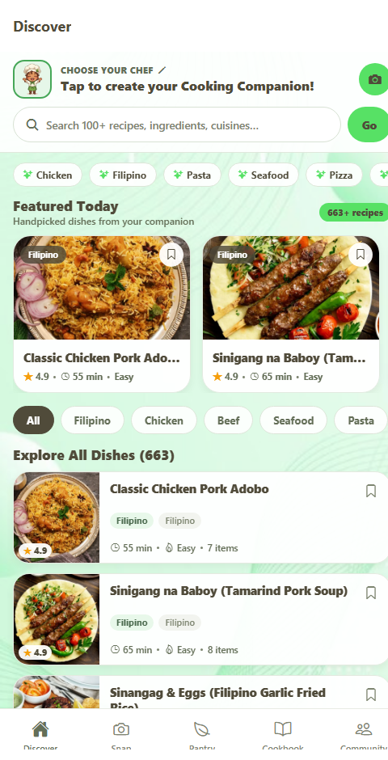
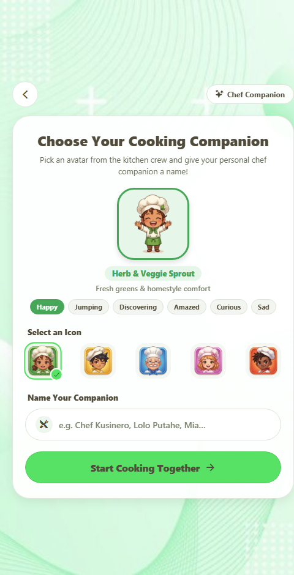
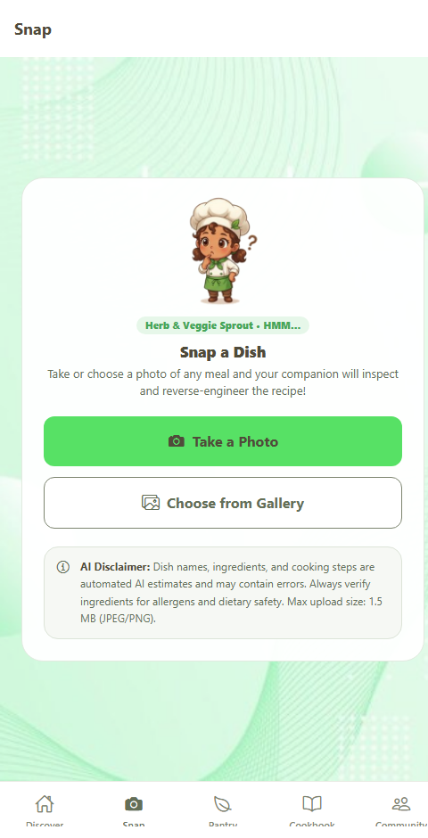
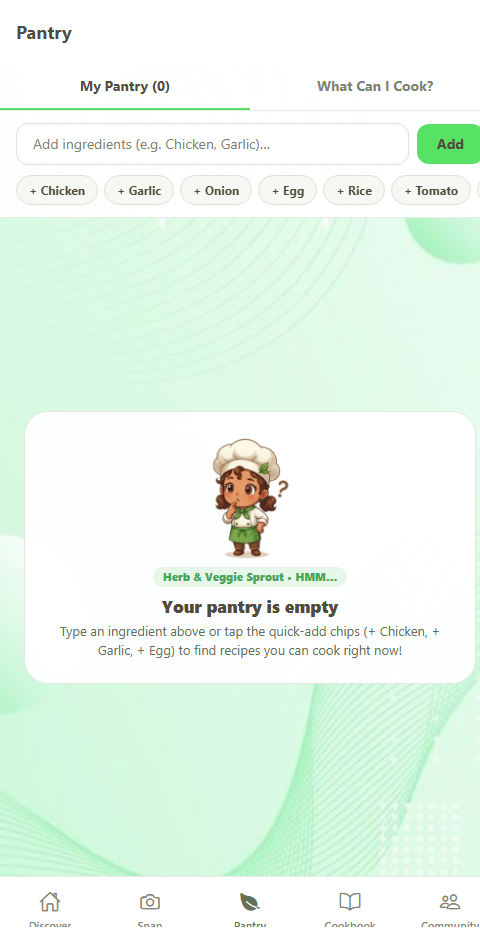
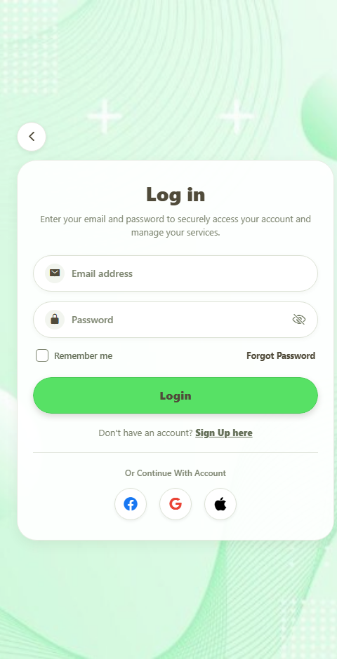
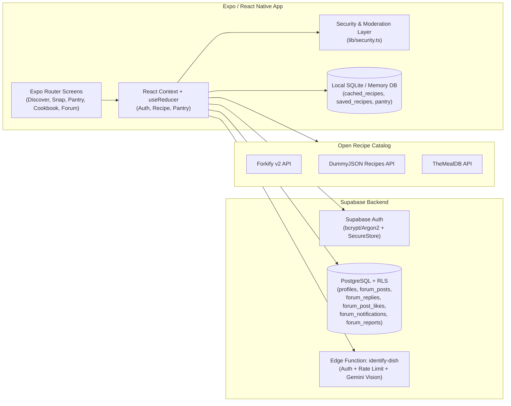

<div align="center">
  

  # Putahe
  **Search. Serve. Smile. — AI-Powered Culinary Discovery, Pantry Matching & Chef Community**

  [](https://expo.dev)
  [](https://reactnative.dev)
  [](https://www.typescriptlang.org/)
  [](https://supabase.com)
  [](https://www.nativewind.dev/)
  [](./LICENSE)
</div>

---

## Overview

**Putahe** (*Filipino for "dish" or "entree"*) is a cross-platform mobile and web culinary companion built with **Expo (React Native)**, **Expo Router**, **SQLite**, and **Supabase**. It empowers home cooks to discover 660+ curated Filipino and international recipes, reverse-engineer dishes from photos using AI Vision, match recipes against leftover pantry ingredients, and connect with fellow chefs in a moderated real-time community forum—all guided by an interactive **Cooking Companion**.

---

## Live Application Screenshots

| Splash & Loading | Discover (`663+` Recipes) | Cooking Companion Setup |
| :---: | :---: | :---: |
|  |  |  |
| **AI Dish Snap & Reverse-Engineer** | **Smart Pantry Ingredient Matcher** | **Authentication & Privacy Consent** |
|  |  |  |

---

## Core Features

### 1. Multi-Source Recipe Discovery (`Discover` Tab)
- **Unified Open Recipe Catalog (`660+` Dishes)**: Aggregates and deduplicates recipes across **Forkify v2**, **DummyJSON Recipes**, **TheMealDB**, and a built-in **Curated Filipino Classics** collection (*Adobo, Sinigang na Baboy, Kare-Kare, Pancit Canton, Sisig, Lumpia, Arroz Caldo, Halo-Halo, Tinola, Bistek, Chicken Inasal, Tortang Talong*).
- **Strict Title & Image Deduplication**: Prevents duplicate dish names or repeated thumbnail URLs across external APIs.
- **Featured Carousel & Quick Cuisines**: Browse featured dishes, filter by category (*Filipino, Chicken, Beef, Seafood, Pasta, Vegetarian, Pork, Dessert*), or search by keyword, ingredient, or cuisine.

### 2. AI Vision Dish Reverse-Engineering (`Snap` Tab)
- **Camera & Gallery Capture**: Snap a photo of any meal or pick an image from your gallery via `expo-image-picker`.
- **Client-Side Compression & Validation**: Resizes images to `≤ 800px` JPEG via `expo-image-manipulator` and validates MIME types (`image/jpeg`, `image/png`, `image/webp`) and payload size (`≤ 1.5 MB`).
- **Supabase Edge Function (`identify-dish`)**: Securely proxies requests to AI Vision (`google/gemini-2.0-flash-001` via OpenRouter) and returns a structured breakdown:
  - Dish verification (`is_food`), identified dish name, and confidence note
  - Full ingredient list with measurements
  - Step-by-step cooking instructions and one-tap **Save to Cookbook**
- **Explicit AI Disclaimers**: Displays clear notices reminding users to verify AI-generated estimates for allergens, dietary restrictions, and safe cooking temperatures.

### 3. Smart Pantry & "What Can I Cook?" (`Pantry` Tab)
- **On-Hand Ingredient Tracker**: Add, toggle active/inactive, or remove pantry ingredients with one-tap quick-add chips (*Chicken, Garlic, Onion, Egg, Rice, Tomato, Pork, Soy Sauce, Potato, Pasta*).
- **Targeted Live + Offline Matching**: Queries live APIs and cached SQLite recipes for your active pantry items, normalizing ingredient names and categorizing dishes into:
  - **Ready to Cook**: You have all required ingredients (or ≥75% match).
  - **Almost Ready**: Missing only 1–3 ingredients, with missing items highlighted on the recipe detail screen.

### 4. Interactive Cooking Companions
- **5 Custom Chef Avatars**: Choose from 5 high-definition chef companions (*Herb & Veggie Sprout, Wok & Flame Striker, Master Broth Lolo, Sweet Whisk Baker, Bold Spice Grillmaster*) and give your companion a custom name.
- **6 Dynamic Reaction Moods**: Your chosen companion reacts contextually across the app with full-body poses (`happy`, `sad`, `jumping`, `discovering`, `amazed`, `curious`).

### 5. Personal Cookbook & Offline SQLite Cache (`Cookbook` Tab)
- **Offline-First Persistence**: Built on `expo-sqlite` (`putahe.db`) with an automatic in-memory fallback for environments without native SQLite binaries.
- **Bookmark & Manage Dishes**: Save recipes from Discover, Snap, or Pantry for instant offline access.

### 6. Community Forum, Profile & Notifications (`Community` Tab)
- **3-Module Segmented Experience**:
  - **Feed**: Browse community threads with real-time updates, **Like** posts (with optimistic counter updates), **Comment** on discussions, **Share** via the native OS share sheet, and **Report** inappropriate content.
  - **My Profile**: View your Cooking Companion badge, chef stats (*My Posts, Likes Earned, Comments*), edit or delete your own posts in-place, and manage account privacy (**Delete Account & Data**).
  - **Alerts (Notifications)**: Track unread activity badges and notifications whenever chefs like, comment on, or share your posts.

---

## Brand Color Palette

| Color Name | Hex Code | Usage |
| :--- | :--- | :--- |
| **Malachite** | `#57E165` | Primary CTA buttons, active tab pills, liked badges, progress bars |
| **White** | `#FFFFFF` | Cards, input surfaces, elevated containers |
| **Dusty Olive (Light)** | `#7D8570` | Secondary labels, placeholders, subtle icons, timestamps |
| **Dusty Olive** | `#646F58` | Subheadings, category tags, active tab icons, borders |
| **Dark Khaki** | `#504B3A` | Primary typography, headings, high-contrast button labels |

---

## Architecture



---

## Project Structure

```text
Putahe/
├── app/
│   ├── _layout.tsx                 # Root layout, splash screen, providers, DB init
│   ├── (auth)/
│   │   ├── _layout.tsx             # Auth stack navigator
│   │   ├── sign-in.tsx             # Login screen with rate-limited auth
│   │   ├── sign-up.tsx             # Registration with explicit privacy consent
│   │   ├── forgot-password.tsx     # Password reset flow
│   │   └── companion-setup.tsx     # Cooking Companion avatar & name selector
│   ├── (tabs)/
│   │   ├── _layout.tsx             # 5-tab bottom navigator (Discover, Snap, Pantry, Cookbook, Community)
│   │   ├── index.tsx               # Discover tab (search, featured carousel, categories)
│   │   ├── snap.tsx                # AI Dish Snap & reverse-engineering screen
│   │   ├── pantry.tsx              # Pantry manager & "What Can I Cook?" matcher
│   │   ├── cookbook.tsx            # Saved recipes collection
│   │   └── forum.tsx               # Community Feed, My Profile & Notifications modules
│   ├── recipe/
│   │   └── [id].tsx                # Full recipe detail & missing-ingredient highlights
│   └── forum/
│       ├── [id].tsx                # Thread detail, likes, shares, comments & reporting
│       └── new.tsx                 # New discussion thread form with moderation checks
├── assets/
│   ├── logo.png                    # Putahe brand logo
│   ├── system-bg.png               # System-wide wave background
│   ├── companion-1..5.png          # 512x512 HD chef companion avatars
│   ├── companions/                 # 30 full-body companion reaction sprites (5 chefs x 6 moods)
│   └── screenshots/                # Live running app screenshots
├── components/
│   ├── CompanionReaction.tsx       # Dynamic companion mood banner component
│   ├── PantryItem.tsx              # Pantry ingredient row with toggle & delete
│   ├── RecipeCard.tsx              # Dish card with rating, time, and save toggle
│   ├── ReplyCard.tsx               # Forum comment card with delete & report actions
│   ├── SplashLoading.tsx           # Animated splash screen
│   ├── SystemBackground.tsx        # Reusable background wrapper
│   └── ThreadCard.tsx              # Forum post card with Like, Comment, Share, Edit, Delete, Report
├── hooks/
│   └── useDatabase.ts              # Typed SQLite CRUD hook
├── lib/
│   ├── companions.ts               # Companion metadata, accents, and sprite mappings
│   ├── database.ts                 # SQLite initializer with automatic in-memory fallback
│   ├── forum.ts                    # Supabase forum, likes, shares, notifications & reporting client
│   ├── matcher.ts                  # Fuzzy pantry-to-recipe ingredient matching engine
│   ├── mealdb.ts                   # Multi-source recipe aggregator & deduplicator
│   ├── security.ts                 # Rate limiting, input sanitization, moderation & safe errors
│   ├── snap.ts                     # Image compression, upload validation & Edge Function client
│   └── supabase.ts                 # Supabase client with chunked LargeSecureStore adapter
├── stores/
│   ├── AuthContext.tsx             # Auth session, companion profile & account deletion context
│   ├── PantryContext.tsx           # Pantry state & multi-source recipe matching context
│   └── RecipeContext.tsx           # Recipe catalog, search, category & cookbook context
├── supabase/
│   ├── functions/
│   │   └── identify-dish/
│   │       └── index.ts            # Deno Edge Function for AI dish identification
│   └── migrations/
│       ├── 001_forum.sql           # Core profiles, forum_posts, forum_replies & RLS
│       ├── 002_forum_social.sql    # forum_post_likes, forum_notifications & Realtime RLS
│       └── 003_security_moderation.sql # Input length constraints, forum_reports & delete_own_account()
├── types/
│   └── index.ts                    # Shared TypeScript interfaces
├── app.json                        # Expo configuration & EAS project metadata
├── package.json                    # Dependencies & scripts
├── tailwind.config.js              # NativeWind brand color tokens
└── tsconfig.json                   # Strict TypeScript configuration
```

---

## Getting Started

### 1. Prerequisites
- **Node.js** `>= 20.x`
- **Expo Go** app installed on your iOS or Android device (or an iOS Simulator / Android Emulator / Web Browser)
- A **Supabase** project (free tier works out of the box)

### 2. Installation

```bash
git clone https://github.com/jjnix-john/Putahe.git
cd Putahe
npm install
```

### 3. Environment Configuration

Copy `.env.example` to `.env.local` and fill in your Supabase project URL and anonymous public key:

```bash
cp .env.example .env.local
```

```ini
EXPO_PUBLIC_SUPABASE_URL=https://your-project-ref.supabase.co
EXPO_PUBLIC_SUPABASE_ANON_KEY=your-supabase-anon-key
```

> **Security Note:** `.env.local` is gitignored. Never commit secret keys or tokens to version control.

### 4. Supabase Database & Edge Function Setup

1. **Run SQL Migrations**: In your Supabase Dashboard → **SQL Editor**, execute the migration files in order:
   - [`supabase/migrations/001_forum.sql`](./supabase/migrations/001_forum.sql)
   - [`supabase/migrations/002_forum_social.sql`](./supabase/migrations/002_forum_social.sql)
   - [`supabase/migrations/003_security_moderation.sql`](./supabase/migrations/003_security_moderation.sql)
2. **Deploy the AI Vision Edge Function** (optional, required for live `Snap` dish reverse-engineering):
   ```bash
   npx supabase secrets set OPENROUTER_API_KEY=your_openrouter_api_key
   npx supabase functions deploy identify-dish
   ```

---

## Running the App

```bash
# Start the Expo development server
npx expo start

# Start with a public tunnel QR code (shareable with friends on any network)
npx expo start --tunnel

# Run directly on Web
npx expo start --web

# Publish an over-the-air preview update via EAS Update
npx eas-cli@latest update --branch preview --message "Putahe preview"
```

### Quality Checks

```bash
# Run ESLint
npx expo lint

# Run TypeScript typechecking
npx tsc --noEmit
```

---

## Security, Privacy & Reliability Practices

- **Input Validation & Sanitization**: All user inputs are sanitized on the client ([`lib/security.ts`](./lib/security.ts)) and validated on the server via PostgreSQL `CHECK` constraints ([`003_security_moderation.sql`](./supabase/migrations/003_security_moderation.sql)) and Edge Function schema checks.
- **Row-Level Authorization**: Every Supabase table (`profiles`, `forum_posts`, `forum_replies`, `forum_post_likes`, `forum_notifications`, `forum_reports`) enforces strict Row-Level Security (`auth.uid() = author_id` / `user_id`), paired with explicit `.eq("author_id", user.id)` ownership checks on mutations.
- **Rate Limiting & Timeouts**: Sliding-window rate limiting protects authentication, forum actions, and AI Snap endpoints (`429 Too Many Requests`), while all third-party API calls use `AbortController` timeouts (`fetchWithTimeout`) and safe fallbacks.
- **Safe Error Masking**: Internal stack traces, SQL/PostgREST codes, and file paths are masked by `toSafeErrorMessage()` before displaying alerts to users.
- **User Consent, AI Disclaimers & Data Deletion**: Sign-up requires explicit consent to the Terms & Privacy Policy, AI Snap screens display clear automated-output disclaimers, and users can permanently delete their account and all associated data from **Community → My Profile → Delete Account**.

---

## License

Distributed under the **MIT License**. See [`LICENSE`](./LICENSE) for full details.
